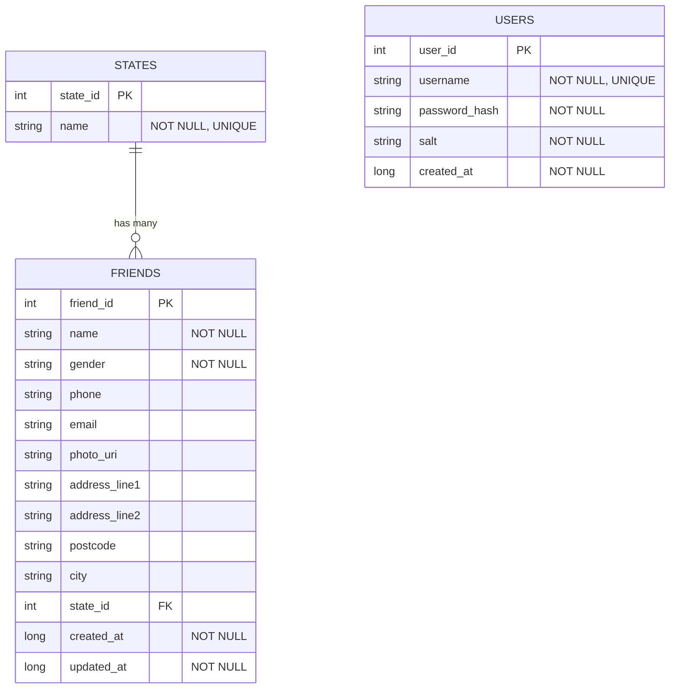

# Entity Relationship Diagram

Paste the block below into any Mermaid renderer (or the Mermaid tab in
Android Studio / VS Code) to regenerate the ERD image for the report.

`USERS` stands alone (authentication). `STATES` is a seeded lookup table so the
"friends per state" report is normalized and consistent. One state has many
friends (`state_id` foreign key on `FRIENDS`).
